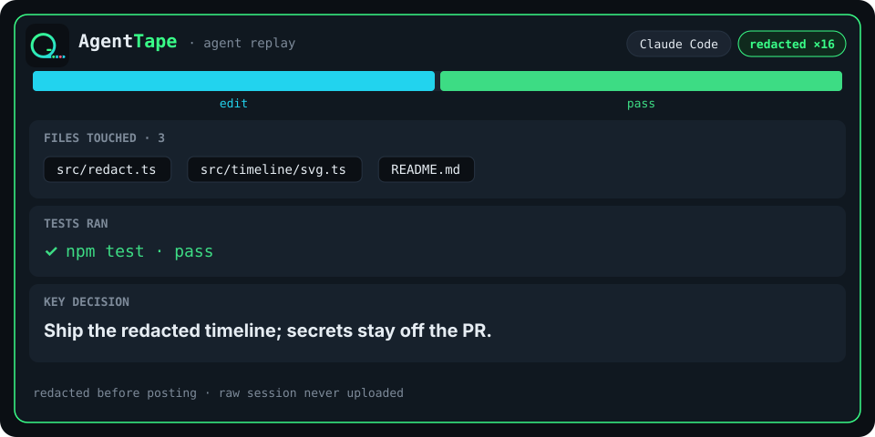

# AgentTape

AgentTape turns a local coding-agent session into a redacted visual timeline a reviewer can read in about five seconds.

## Happy path

```bash
npm install -g agenttape
npx agenttape pr
npx agenttape pr --dry-run
npx agenttape pr --json --dry-run
```

Run it on the git branch that already has the pull request. One command, `npx agenttape pr`, reads the newest Claude Code or Aider session, posts a comment that leads with the timeline PNG, and does not ask you to upload anything yourself. `--dry-run` prints that comment and does not push or comment. If `gh` is missing, not authenticated, or the PNG push is denied, AgentTape prints what failed and how to fix it, then uses a text timeline instead. It does not claim an image was posted.

From a checkout, before the package is on npm: `npx tsx src/cli.ts pr --dry-run`.

## What a reviewer sees

On the happy path the comment leads with the image, then the decision and a short table:

```markdown


**Ship the redacted timeline.**

| | |
| --- | --- |
| Files touched | `src/redact.ts` · `src/timeline/svg.ts` |
| Tests | yes · pass |
```

ASCII and mermaid appear only when the PNG was not pushed. The preview below is the SVG checked into this repo, not the orphan ref:



Tokens in square brackets in the fixture render are redaction markers, not real secrets.

## Orphan ref

`agenttape pr` builds a parentless commit (PNG + a tiny README) with `git hash-object`, `git mktree`, and `git commit-tree` in a temp repository. It then runs:

```text
git push origin +<commit>:refs/agenttape/<head>
```

`<head>` is the SHA already on your branch. The new commit has no parent, and the destination is `refs/agenttape/…`, not `refs/heads/…`, so it cannot merge into main and it is not your PR branch. The push does not update your index or working tree, and it does not create `.agenttape/`.

The comment image is exactly:

```text
https://github.com/<owner>/<repo>/raw/<commit>/timeline.png
```

`<commit>` is the orphan commit that contains the PNG, not `raw.githubusercontent.com`. On a **public** repo, a logged-out viewer loading that `github.com/.../raw/<sha>/...` URL sees the image.

## Who can see the PNG

Visibility is not the same on public and private repos.

- **Public repo.** Anonymous viewers see the PNG at `github.com/.../raw/<sha>/...`.
- **Private repo.** Logged-out users, email notifications, and some mobile clients may show a broken image. Collaborators who can open the repo usually see it.

If `gh` is missing or not logged in, or the push to `refs/agenttape/…` is denied, the command prints a one-glance error (what failed, and the fix) and posts or prints the text timeline only. That comment has no image URL.

## Demo

A recorded GIF belongs at `docs/demo.gif`. It is not in v0.1. Before announcing the release, replace this note with a short capture of `npx agenttape pr --dry-run` and the comment it would post. Until then, the SVG above is the visual.

## Redaction

On by default, before anything is rendered or posted:

| Pattern | Replaced with |
| --- | --- |
| `sk-ant-…` and other `sk-…` keys | `[REDACTED_API_KEY]` |
| GitHub tokens `ghp_`, `gho_`, `ghu_`, `ghs_`, `ghr_` | `[REDACTED_GITHUB_TOKEN]` |
| AWS access key ids (`AKIA` / `ASIA` / `AIDA` / `AROA`) and `AWS_SECRET_ACCESS_KEY=` values | `[REDACTED_AWS_KEY]` |
| Private IPv4 (`10/8`, `172.16/12`, `192.168/16`) and link-local | `[REDACTED_IP]` |
| Hostnames ending in `.internal` or `.local` | `[REDACTED_HOST]` |

Emails are kept unless you pass `--redact-emails`. This is prefix matching, not a secret scanner. A novel credential that does not match these shapes can still slip through.

## Adapters

- **Claude Code.** Top-level `*.jsonl` under `~/.claude/projects` (or `$CLAUDE_CONFIG_DIR`). Subagent files are ignored. The timeline follows the newest leaf of the `uuid` / `parentUuid` tree so a rewind does not leak the abandoned branch. `thinking` blocks are never copied. The assumed line shape is documented in `src/adapters/claude.ts`; unknown fields and broken lines are skipped.
- **Aider.** `.aider.chat.history.md` in the repo or a parent directory. The last `# aider chat started at` session is the one that is rendered. Grammar notes are in `src/adapters/aider.ts`.

`--source claude` or `--source aider` forces one. `--session <file>` skips discovery. With `--source auto`, the newer file wins.

## Compared with ai-session

[ai-session](https://github.com/gammons/ai-session) archives the Claude Code transcript (scrubbed) in a side repo and links it from commits and a pull-request table. AgentTape does not archive the transcript. It posts one redacted timeline — files touched, tests ran or not, and a one-line decision — so the review stays a glance. Redaction is on by default, and the raw session is not written into the working tree.

## Local development

```bash
npm install
npm test
npx tsx src/cli.ts pr --dry-run --session fixtures/claude-session.jsonl
```

Fixtures under `fixtures/` are synthetic. The strings that look like keys are canaries so tests can prove they never appear in the comment, the SVG, or the JSON.

The package is ready to publish as `agenttape` (`bin` points at `dist/cli.js`). This repo does not publish it.

## v0.2

Not in this release:

- A Claude Code `SessionEnd` hook that runs `agenttape pr` when a session ends.
- Cursor session reading. Explicitly later. v0.1 does not read Cursor transcripts.
- Still no `prepare-commit-msg` hook, and still no `.agenttape/` directory in the repo.

## GitHub Action

There is no workflow in v0.1. Sessions live on the developer machine, so a hosted runner cannot see them. Notes: [docs/github-action.md](docs/github-action.md).

## 繁體中文

AgentTape 把本機的程式代理工作階段（Claude Code 或 Aider）整理成一份預設已遮罩機密的 PR 時間軸，讓審查者大約五秒內看懂：動了哪些檔案、有沒有跑測試，以及一行決策摘要。

```bash
npx agenttape pr
npx agenttape pr --dry-run
```

原始工作階段不會寫進專案目錄。PNG 放在 `refs/agenttape/<head>`，不會進 main。公開倉庫的未登入讀者也看得到 `github.com/.../raw/<sha>/timeline.png`；私人倉庫則不同，未登入、郵件通知與部分手機客戶端可能只看到破圖，有權限的協作者通常看得到。Cursor 支援與 Claude Code `SessionEnd` hook 留到 v0.2。

## License

MIT. See [LICENSE](LICENSE).
