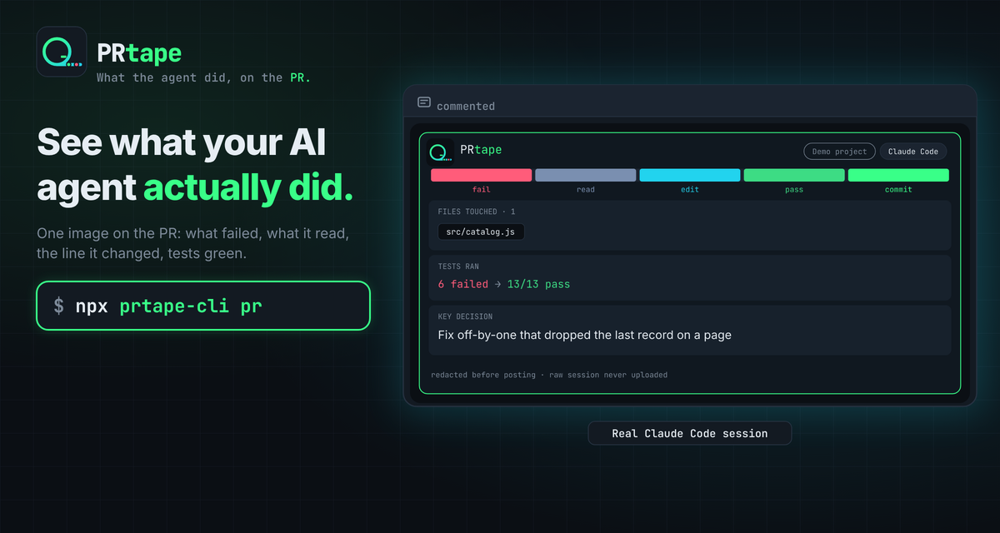
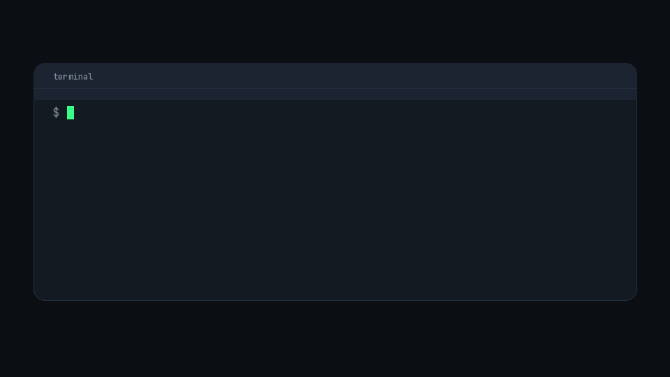

# PRtape



See what your AI agent actually did.

```bash
npx prtape-cli pr
```



After a global install (`npm i -g prtape-cli`) the command is `prtape`.

- Reads the newest Claude Code session on your machine.
- Posts one redacted image on the pull request: files touched, tests, and the decision.
- Leaves the raw session off the PR.

## Happy path

```bash
npm i -g prtape-cli
npx prtape-cli pr
npx prtape-cli pr --dry-run
npx prtape-cli pr --json --dry-run
```

Run it on the git branch that already has the pull request. One command, `npx prtape-cli pr`, reads the newest Claude Code session, posts a comment that leads with the timeline PNG, and does not ask you to upload anything yourself. `--dry-run` prints that comment and does not push or comment. If `gh` is missing, not authenticated, or the PNG push is denied, PRtape prints what failed and how to fix it, then uses a text timeline instead. It does not claim an image was posted.

From a checkout, before the package is on npm: `npx tsx src/cli.ts pr --dry-run`.

## What a reviewer sees

On the happy path the comment leads with the image, then the decision and a short table:

```markdown


**Ship the redacted timeline.**

| | |
| --- | --- |
| Files touched | `src/redact.ts` · `src/timeline/svg.ts` |
| Tests | yes · pass |
```

## Orphan ref

`prtape pr` builds a parentless commit whose tree is only `timeline.png`, using `git hash-object`, `git mktree`, and `git commit-tree` in a temp repository. It then runs:

```text
git push origin +<commit>:refs/prtape/<head>
```

`<head>` is the SHA already on your branch. The new commit has no parent, and the destination is `refs/prtape/…`, not `refs/heads/…`, so it cannot merge into main and it is not your PR branch. The push does not update your index or working tree, and it does not create `.prtape/`. The tree contains `timeline.png` and nothing else. Running `prtape pr` again updates the latest PRtape comment on that pull request. A comment posted under this project's earlier name, AgentTape, is updated in place instead of posting a second one.

The comment image is exactly:

```text
https://github.com/<owner>/<repo>/raw/<commit>/timeline.png
```

`<commit>` is the orphan commit that contains the PNG, not `raw.githubusercontent.com`. On a **public** repo, a logged-out viewer loading that `github.com/.../raw/<sha>/...` URL sees the image.

## Who can see the PNG

Visibility is not the same on public and private repos.

- **Public repo.** Anonymous viewers see the PNG at `github.com/.../raw/<sha>/...`.
- **Private repo.** Logged-out users, email notifications, and some mobile clients may show a broken image. Collaborators who can open the repo usually see it.

If `gh` is missing or not logged in, or the push to `refs/prtape/…` is denied, the command prints a one-glance error (what failed, and the fix) and posts or prints the text timeline only. That comment has no image URL.

## Redaction

v0.1 drops a span only when it matches one of these fixed formats:

| Format | What actually matches |
| --- | --- |
| `sk-` API keys | `sk-ant-` plus at least 8 characters, or `sk-` plus at least 8 characters. `sk-test` is left as-is. |
| GitHub tokens | `ghp_`, `gho_`, `ghu_`, `ghs_`, or `ghr_` plus at least 20 characters. |
| AWS keys | Access key ids `AKIA`, `ASIA`, `AIDA`, or `AROA` plus 16 characters, and values after `AWS_SECRET_ACCESS_KEY=`. |
| Private IPv4 | `10/8`, `172.16/12`, `192.168/16`, and link-local `169.254/16`. Loopback addresses stay. |
| Hostnames | Names ending in `.internal` or `.local`. `localhost` stays. |
| Email addresses | On by default in the comment, the timeline image, and JSON. `--no-redact-emails` leaves them visible. `--redact-emails` is accepted and still turns them on. |
| Database URLs | `postgres`, `postgresql`, `mysql`, `mongodb`, `mongodb+srv`, `redis`, `rediss`, and `amqp` URLs that contain `user:password@host`. A URL with no password is left as-is. |
| Password assignments | `password=`, `PASSWORD:`, `passwd=`, and `pwd=` values. The word password in a sentence, with no value, stays. |
| Extra domains | `--redact-domain <domain>`, or comma-separated `PRTAPE_REDACT_DOMAINS`, also removes that domain, its subdomains, and an optional port. No company domain is built in. |

`pr` posts the comment directly, so run `npx prtape-cli pr --dry-run` first to review what will be posted.

A matching span is removed from the pull-request comment, the timeline image, and the JSON a reviewer would read. The card does not print a replacement token.

## Sessions

Claude Code only for now. PRtape reads top-level `*.jsonl` under `~/.claude/projects` (or `$CLAUDE_CONFIG_DIR`). Subagent files are ignored. The timeline follows the newest leaf of the `uuid` / `parentUuid` tree so a rewind does not leak the abandoned branch. `thinking` blocks are never copied. The assumed line shape is documented in `src/adapters/claude.ts`; unknown fields and broken lines are skipped.

`--source claude` forces that reader. `--session <file>` skips discovery.

## Compared with ai-session

[ai-session](https://github.com/gammons/ai-session) archives the Claude Code transcript (scrubbed) in a side repo and links it from commits and a pull-request table. PRtape does not archive the transcript. It posts one redacted image — files touched, tests ran or not, and a one-line decision — so the review stays a glance. Redaction is on by default, and the raw session is not written into the working tree.

## Local development

```bash
npm install
npm test
npx tsx src/cli.ts pr --dry-run --session fixtures/claude-session.jsonl
```

Fixtures under `fixtures/` are synthetic. The strings that look like keys are canaries so tests can prove they never appear in the comment, the SVG, or the JSON.

The package is published on npm as `prtape-cli` (`bin` points at `dist/cli.js`).

## v0.2

Not in this release:

- A Claude Code `SessionEnd` hook that runs `prtape pr` when a session ends.
- Cursor session reading, planned for v0.2 alongside the Claude Code `SessionEnd` hook. v0.1 does not read Cursor transcripts.
- Still no `prepare-commit-msg` hook, and still no `.prtape/` directory in the repo.

## GitHub Action

There is no workflow in v0.1. Sessions live on the developer machine, so a hosted runner cannot see them. Notes: [docs/github-action.md](docs/github-action.md).

## 繁體中文

PRtape 把本機的 Claude Code 工作階段整理成一張 PR 圖，讓審查者大約五秒內看懂：動了哪些檔案、有沒有跑測試，以及一行決策摘要。預設只刪除固定的常見金鑰格式，不是所有機密。目前只支援 Claude Code。

```bash
npx prtape-cli pr
npx prtape-cli pr --dry-run
```

原始工作階段不會寫進專案目錄。PNG 放在 `refs/prtape/<head>`，不會進 main。公開倉庫的未登入讀者也看得到 `github.com/.../raw/<sha>/timeline.png`；私人倉庫則不同，未登入、郵件通知與部分手機客戶端可能只看到破圖，有權限的協作者通常看得到。Cursor 支援與 Claude Code `SessionEnd` hook 留到 v0.2。

## FAQ

ASCII and mermaid appear only when the PNG was not pushed.

Tokens in square brackets in the fixture render are redaction markers, not real secrets.

## License

MIT. See [LICENSE](LICENSE).
