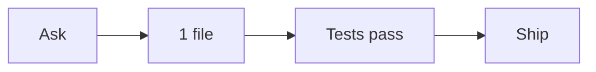

### AgentTape

**Ship the redacted timeline. Do not print [REDACTED_GITHUB_TOKEN].**

```text
ask ──▶ 1 file ──▶ tests pass ──▶ ship
```

| | |
| --- | --- |
| Source | Aider · 2026-11-01 15:04 |
| Files touched | `src/redact.ts` |
| Tests | yes · pass · `npm test` |



<details>
<summary>Steps</summary>

1. **Ask** — Strip secrets before posting the timeline.
2. **Edit** — `src/redact.ts`
3. **Test** — `npm test` · pass
4. **Decision** — Ship the redacted timeline. Do not print [REDACTED_GITHUB_TOKEN].

</details>

_Redacted locally by AgentTape 0.1.0. The raw session was not posted. This is the text timeline (ASCII + mermaid). GitHub strips inline SVG._
