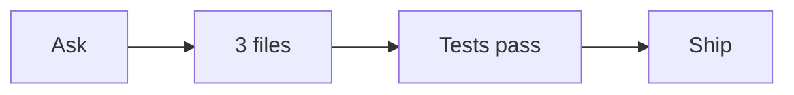

### AgentTape

**Ship the redacted timeline. Left [REDACTED_API_KEY] off the PR.**

```text
ask ──▶ 3 files ──▶ tests pass ──▶ ship
```

| | |
| --- | --- |
| Source | Claude Code · `feature/redact-timeline` · 2026-11-01 15:04 UTC |
| Files touched | `src/redact.ts` · `src/timeline/svg.ts` · `README.md` |
| Tests | yes · pass · `AWS_SECRET_ACCESS_KEY=[REDACTED_AWS_KEY] npm test` |



<details>
<summary>Steps</summary>

1. **Ask** — Strip keys and internal hosts before posting.
2. **Edit** — `src/redact.ts`
3. **Edit** — `src/timeline/svg.ts`
4. **Write** — `README.md`
5. **Test** — `AWS_SECRET_ACCESS_KEY=[REDACTED_AWS_KEY] npm test` · pass
6. **Decision** — Ship the redacted timeline. Left [REDACTED_API_KEY] off the PR.

</details>

_Redacted locally by AgentTape 0.1.0. The raw session was not posted. GitHub comments strip inline SVG; the SVG timeline is on the machine that ran the CLI._
