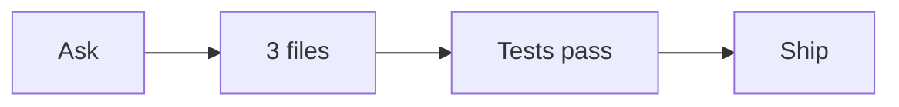

### PRtape

<!-- prtape -->

**Ship the redacted timeline; secrets stay off the PR.**

```text
ask ──▶ 3 files ──▶ tests pass ──▶ ship
```

| | |
| --- | --- |
| Source | Claude Code · `feature/redact-timeline` · 2026-11-01 15:04 UTC |
| Files touched | `src/redact.ts` · `src/timeline/svg.ts` · `README.md` |
| Tests | npm test · pass |



<details>
<summary>Steps</summary>

1. **Ask** — Strip keys and internal hosts before posting.
2. **Read** — `src/redact.ts`
3. **Edit** — `src/redact.ts`
4. **Edit** — `src/timeline/svg.ts`
5. **Write** — `README.md`
6. **Test** — `npm test` · pass
7. **Decision** — Ship the redacted timeline; secrets stay off the PR.

</details>

_Redacted locally by PRtape 0.1.1. The raw session was not posted. This is the text timeline (ASCII + mermaid). GitHub strips inline SVG._
